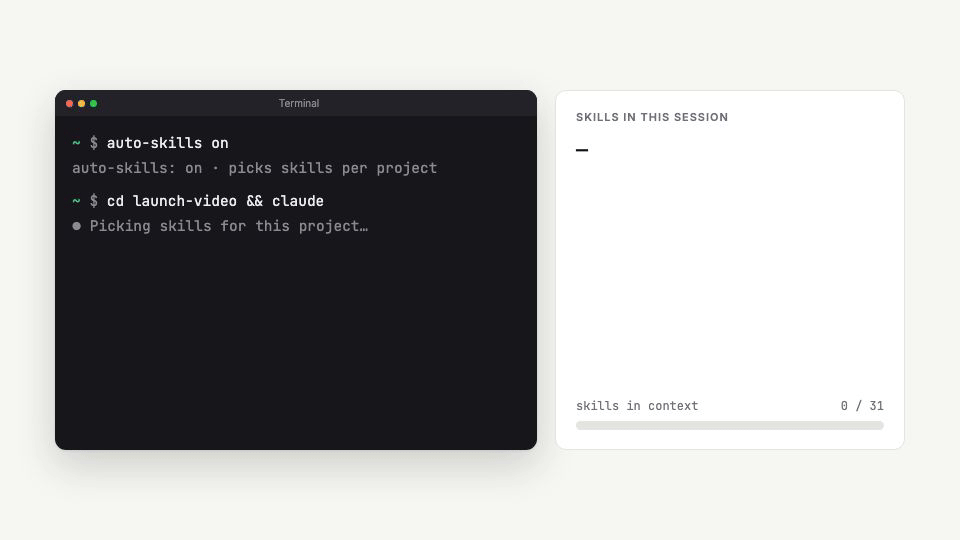

# auto-skills

**The right Claude Code skills for each project, turned on automatically.**




Claude loads every skill you have into every session. auto-skills turns on only the ones each
project needs: your video skills in a Remotion repo, your design skills in a Next.js app.

## Install

```
/plugin marketplace add anthonyych4n/auto-skills
/plugin install auto-skills@auto-skills
```

Then tell Claude: **"set up auto-skills"**. It asks where your skills are and sets up starter rules.

## Use it

Just ask Claude:

| Say | What happens |
|---|---|
| "turn on my design skills here" | design skills on for this project |
| "use my video skills in Remotion projects" | adds a rule, so it happens automatically |
| "what skills does this project get?" | shows what's on and why |
| "pause auto-skills" | stops switching skills (and "resume" to start again) |

<details>
<summary><b>Watch the full 30-second demo (with sound)</b></summary>

https://github.com/user-attachments/assets/90390974-cb0d-4612-b986-012884e55125

</details>

<details>
<summary><b>How it works</b></summary>

Your skills live in a library folder instead of `~/.claude/skills`. When a session starts, a hook
checks the project's `package.json` and files against your rules, links the matching skills into
`<project>/.claude/skills/` (git-excluded, so they're never committed), and reloads skills so
they're ready right away. It takes about 0.1 s and never touches other projects.

Rules live in `<library>/AUTO`, one per line:

```
dep  remotion            motion stageshow     # package.json dependency (globs ok: @remotion/*)
dep  next                design
file components.json     design               # file or glob in the project root
```

A target is a skill folder or a category folder (`design/` turns on every skill in it). Rules that
name skills you don't have are skipped. Starter rules: [rules.example](rules.example).

</details>

<details>
<summary><b>Without the plugin system (CLI)</b></summary>

Needs `python3`.

```bash
git clone https://github.com/anthonyych4n/auto-skills ~/auto-skills
ln -s ~/auto-skills/bin/auto-skills ~/.local/bin/auto-skills
auto-skills init --library ~/path/to/your/skills
auto-skills install-hook     # adds the hook to ~/.claude/settings.json (backed up first)
```

Commands: `check [dir]` · `use <skill|category>` (`--off`, `--list`) · `on` / `off` · `status`.
Opt a project out with `touch .claude/.no-auto-skills`.

</details>

<details>
<summary><b>Develop</b></summary>

```bash
python3 -m unittest discover tests
cd demo && npm install && npm run studio    # the launch video, made with Remotion
```

</details>

MIT licensed.
